<p align="center">
  
</p>

<p align="center"><strong>Invoicing for your business and the agents that work for it.</strong></p>

<p align="center">
Billr is the billing workspace you run for your own business: clients, invoices, estimates, engagements, time, expenses, payments and reports.
It is also an MCP server, so a coding agent can do the same work with a scoped key you can revoke, and every document it touches stays in an application a person can open.
</p>

<p align="center">
  <a href="LICENSE"></a>
  <a href=".nvmrc"></a>
  <a href="https://github.com/ethanplusai/billr/actions/workflows/ci.yml"></a>
</p>

**Prefer not to run it yourself? [billr.cc](https://billr.cc) is the hosted version of Billr.**

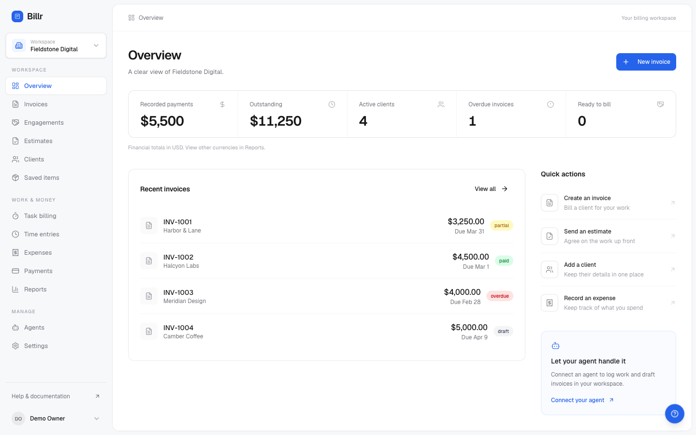

## What it is

Billr is self-hosted invoicing built for working with agents. You run it on your own computer or server, you and your agents bill your clients from it, and the only outside people who ever see it are those clients, on the invoice and estimate pages Billr sends them.

- **One owner.** The first person to sign up owns the installation, and sign-up closes behind them.
- **Your Stripe account.** Card payments go straight to the Stripe account whose keys you put in the environment. Nothing sits in the middle and nothing is added on top of Stripe's fee.
- **Your database.** Everything lives in a Supabase project you control: on your laptop, on your own server, or managed.
- **Your agents.** Claude Code, Codex, Cursor and any MCP client connect by URL to `/api/mcp` on your installation.

## Quick start

You need Node.js 22 or newer, Docker (running) and the [Supabase CLI](https://supabase.com/docs/guides/local-development/cli/getting-started) 2.67.1 or newer.

```sh
git clone https://github.com/ethanplusai/billr.git
cd billr/app
npm run doctor
npm ci
npm run setup:local
npm run dev -- --hostname 127.0.0.1
```

Open http://localhost:3000 and sign up: that account owns this Billr. Create a business, add a client, create an invoice and download its PDF.

`npm run doctor` checks Node.js, Docker, the Supabase CLI and the local ports before anything is installed. `npm run setup:local` starts an isolated local Supabase project, applies the database schema and writes local credentials to an ignored `.env.local` with mode 0600; it refuses to overwrite an existing one. This local stack is for your machine only; do not expose its development credentials on a public server. Installing on a new computer for the first time? [docs/fresh-machine-test.md](docs/fresh-machine-test.md) walks through every step, with what success looks like at each one.

Then open **Agents → Connect** for the MCP URL of your installation, or **Agents → API Keys** to create a key with the permissions your agent needs. A local agent connects to `http://localhost:3000/api/mcp`; an agent running on another machine needs a deployment it can reach.

Card payments and invoice email are optional. Add your Stripe keys or a Resend key when you want them: see [docs/self-hosting.md](docs/self-hosting.md).

## What you can do

### Clients

Contact details, billing address, currency, payment terms, tax id and internal notes that never appear on a document. Per-client totals, invoiced and outstanding, are maintained by the database rather than recomputed in the browser, so a list and a detail page can never disagree.

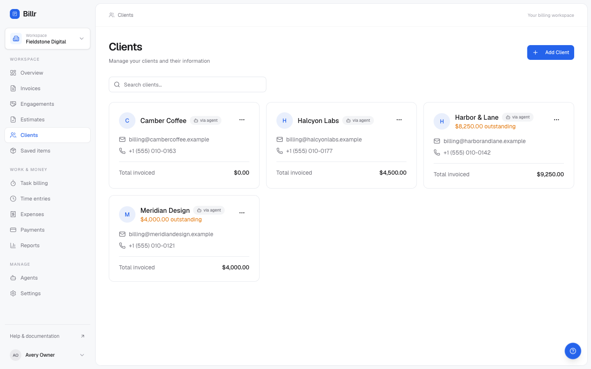

### Invoices and estimates

- Line items with quantities, rates, percentage or fixed discounts, tax and shipping, all totalled on the server.
- Numbering is per business with a configurable prefix, and a document is created in a single database transaction, so a half-written invoice never exists.
- Statuses: draft, sent, viewed, partial, paid, overdue, cancelled. The list filters on them and the dashboard counts them.
- **Duplicate** an invoice into a new draft, or **convert** an accepted estimate into an invoice or an engagement, keeping the link between the two.
- Invoices and estimates each get a public page at a secret `public_id`, and an invoice also renders as a PDF that the client can download or that Billr attaches when it emails the invoice.

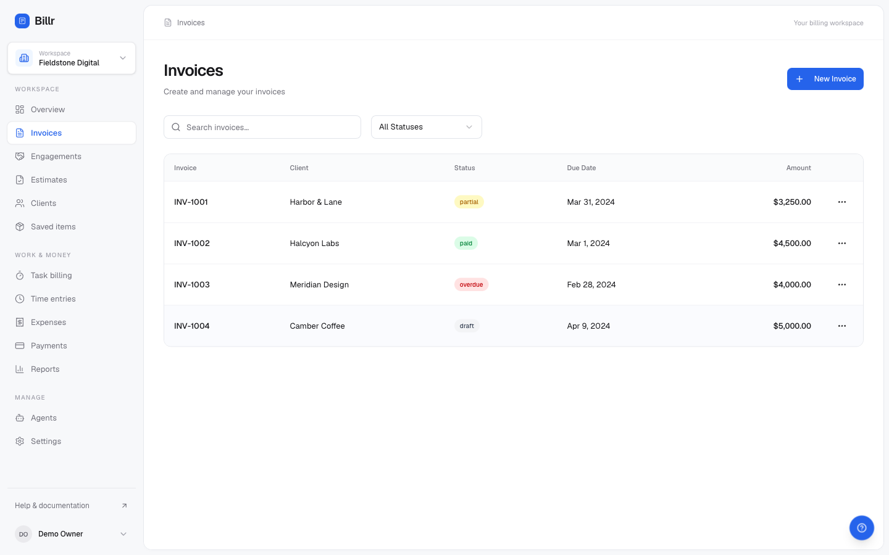

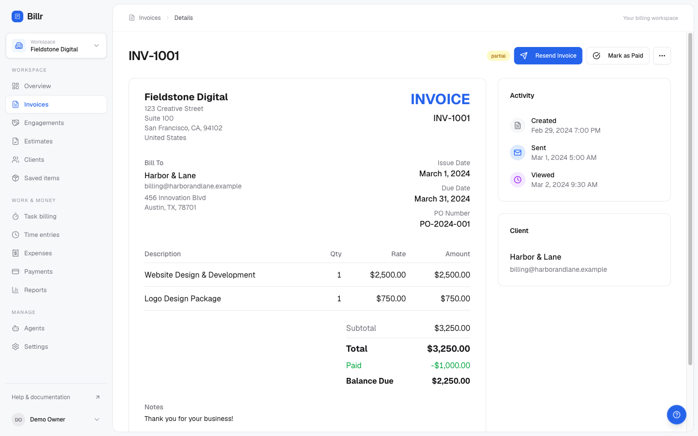

An accepted estimate keeps its own page, with one button to turn it into an invoice and another to turn it into an engagement.

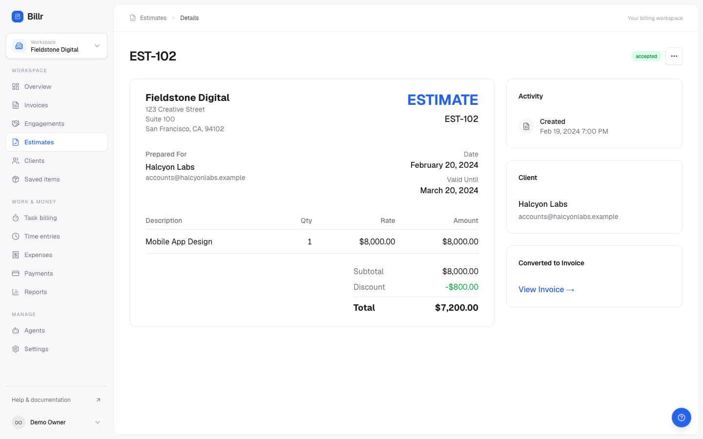

The public page is what your client gets. It is served through dedicated read-only database functions keyed on the `public_id`, never through a broad table policy, and the payload is an explicit allow-list of columns: adding a column to `businesses` or `clients` cannot widen what a client can see. When your Stripe keys are set, the client pays by card right on this page.

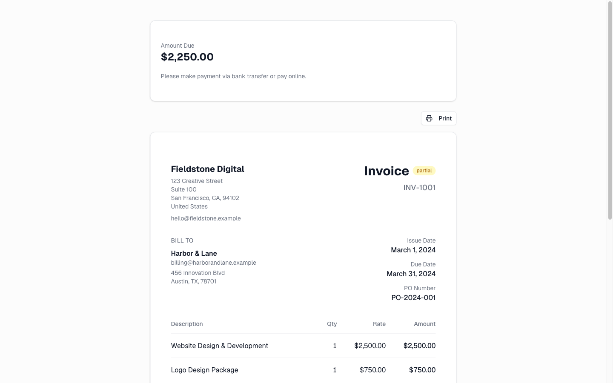

### Time and expenses to unbilled to invoice

Log time and expenses against a client, in the client's currency, billable or not. The unbilled list is the working surface: pick entries, pull them onto a draft invoice in one step, and they are marked billed in the same step, so the same hour cannot be billed twice.

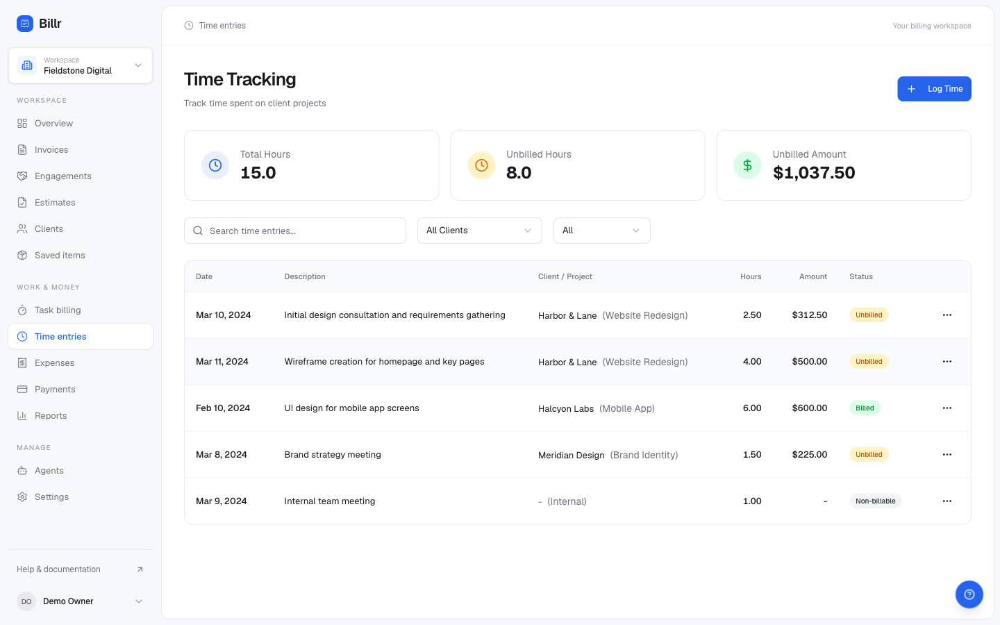

### Engagements

An engagement is an agreed total and the schedule it will be billed off, so work is billed against something that was agreed rather than invented per invoice.

- Billing modes: `percent_split`, `equal_installments`, `milestones` and `manual`.
- Each schedule entry becomes billable by a rule: `on_start`, `on_complete`, `on_milestone`, `on_date` or `manual`.
- The database enforces that entries add up to exactly the total, and rounding is decided in one place: the last entry absorbs the remainder.
- An entry that has been invoiced is frozen. The agreed total, currency, billing mode and schedule are deliberately not editable after the fact.
- Nothing is ever sent by an engagement. Becoming ready to bill is a status; turning it into an invoice and sending that invoice stay separate, deliberate steps.

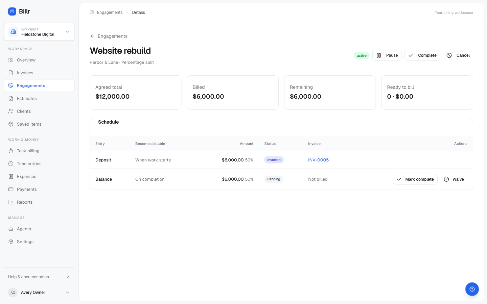

### Payments

- Record what actually arrived: cash, check, bank transfer, card, PayPal or anything else. No Stripe account required.
- Balances and statuses are reconciled by the database, not by the page you happen to be looking at.
- A payment recorded wrong can be **corrected**, or **voided** with a reason. A voided row stays, struck through, and stops counting as money: the invoice reopens for that amount and every total leaves it out.
- Card payments use **your own Stripe account**, set with three environment variables. Card details go from your client's browser to Stripe; the charged amount is always re-derived from the invoice on the server. Stripe confirms the result over a signed webhook, and events are processed once, so a redelivered webhook cannot pay an invoice twice.
- Refunds and disputes raised in your Stripe dashboard flow back the same way.

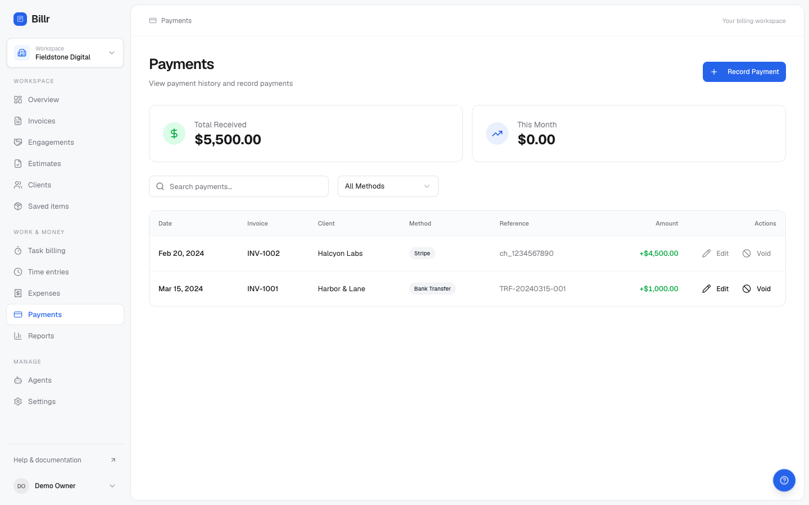

### Task billing for agents

An agent opens a task under pricing a person approved, heartbeats while it works, reports what its providers cost, and completes. Then a person reviews and decides.

- An owner or admin approves a policy per client: currency, hourly rate, usage multiplier and a per-task budget. Missing pricing is never treated as zero.
- Time is measured from server timestamps, and each heartbeat records at most 120 seconds since the previous one, so a long gap cannot silently become a billable hour.
- The arithmetic is stated in full: `time = active_seconds x hourly_rate / 3600`, `usage = reported_provider_cost x usage_multiplier`, `total = time + usage`.
- Billr does not fetch provider invoices or infer prices from model names. Reported usage needs a provider request reference and an evidence source, and a reference can be billed only once per business and provider.
- Completing freezes the record. Approving the cost and creating the draft invoice is a human action, and sending it is another one.

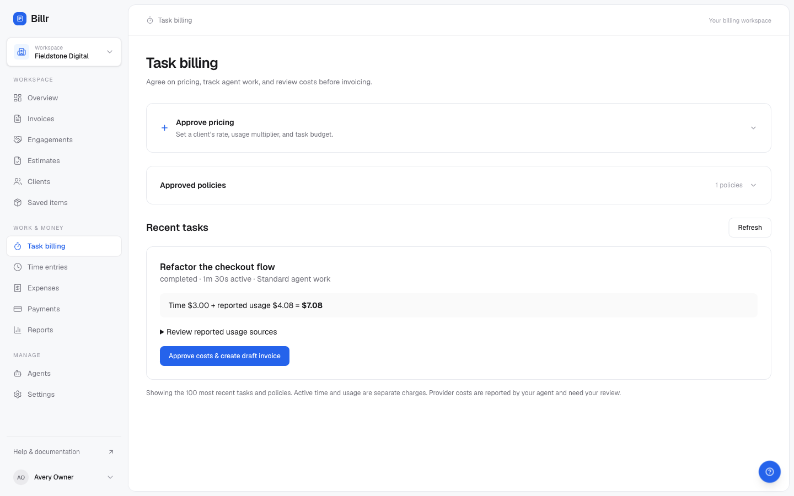

### The MCP server

The MCP server is part of the app, at `/api/mcp` on your installation. It exposes **53 tools** in ten groups: clients, invoices, estimates, engagements, saved items, time, expenses, payments, task billing, and business and links. The tool reference in `plugins/shared/skill/references/tools.md` is generated from the same catalog the server registers, so a documented tool that does not exist cannot ship.

**Connect by URL.** Your installation is an OAuth 2.1 authorization server and protected resource, published at `/.well-known/oauth-authorization-server` and `/.well-known/oauth-protected-resource`. A client that supports remote MCP discovers it, registers itself, sends you to a normal sign-in, and receives a short-lived token instead of a key you paste around.

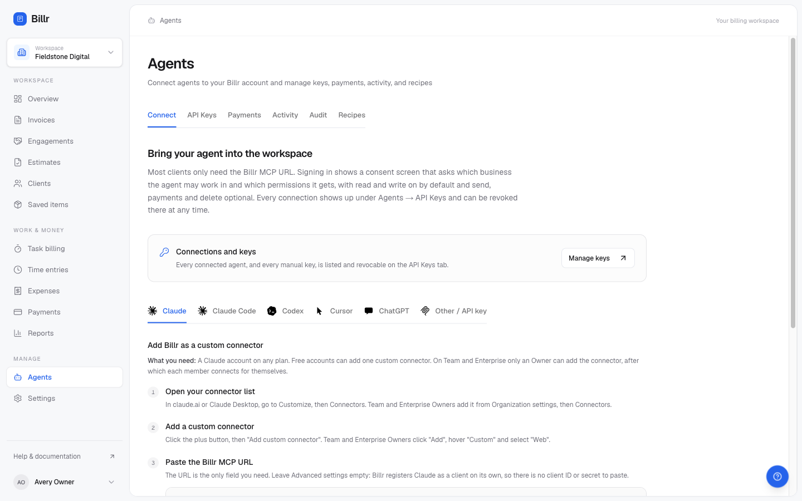

Claude Code:

```sh
claude mcp add --transport http billr https://YOUR_APP/api/mcp
```

Then run `/mcp` inside Claude Code, choose `billr`, authenticate in the browser, and confirm with `claude mcp list`.

Codex:

```sh
codex mcp add billr --url https://YOUR_APP/api/mcp
codex mcp login billr
codex mcp list
```

Cursor, ChatGPT and any other client that speaks streamable HTTP MCP are covered in **Agents → Connect** and in [plugins/README.md](plugins/README.md).

For hosted Billr, see the [Claude installation guide](https://billr.cc/docs/connect) and [Cursor installation guide](https://billr.cc/docs/connect). Their plugin packages are maintained separately from this self-hosted repository.

**The consent screen.** Signing in shows one page that asks which business the agent may work in and which permissions it gets. Reading is the floor and cannot be unticked; send, payments and delete are off unless you turn them on. Access expires in 30 days unless the agent refreshes it, and every connection is revocable from **Agents → API Keys**.

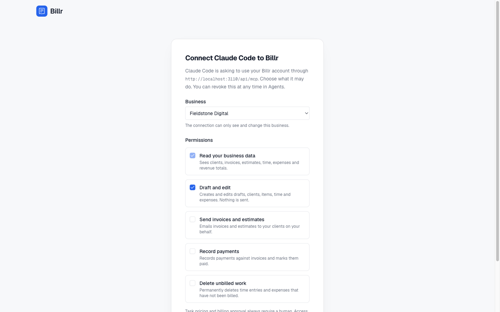

**API keys and scopes.** For clients that cannot do OAuth, create a `billr_sk_` key. It is shown once, stored only as a SHA-256 hash, scopable to one business and expiring in 90 days. Keys are granted as profiles:

| Profile | Permissions | What it can do |
| --- | --- | --- |
| Read only | `read` | Look at clients, documents, work and revenue totals |
| Read and draft | `read`, `write` | The above, plus create and edit drafts, clients, items, time and expenses |
| Billing | `read`, `write`, `send`, `payments` | The above, plus email documents and record payments |
| Full | `read`, `write`, `send`, `payments`, `delete` | The above, plus delete unbilled time and expenses |

Every tool maps to exactly one permission and an uncategorised tool is denied, so a new tool cannot quietly inherit access. The scope is re-checked when a tool runs, so revoking takes effect on the next call. Task pricing and task invoice approval always require a person, whatever the key says.

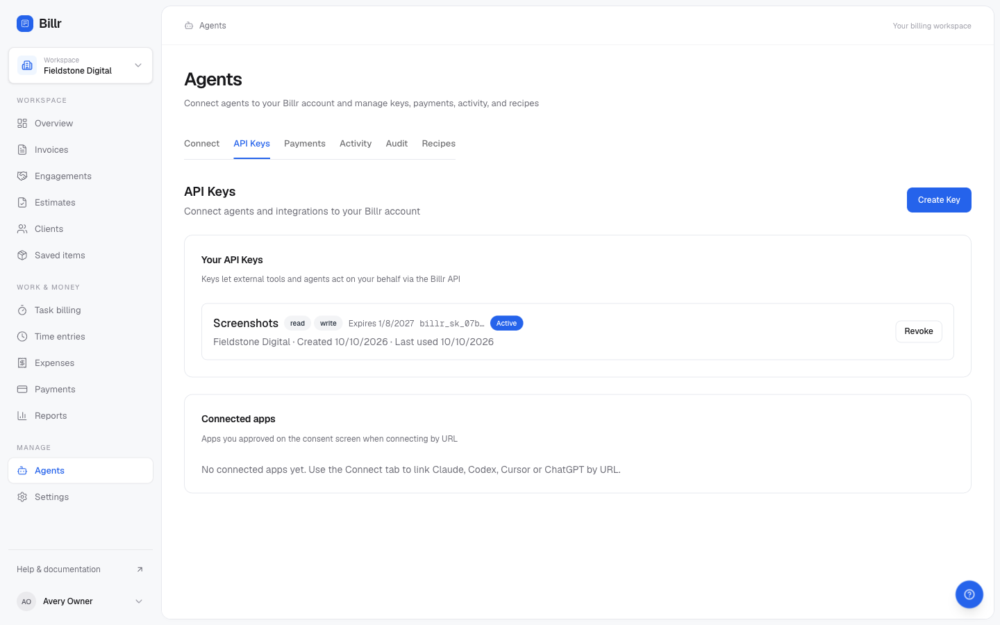

Write tools take a stable `request_id`, so a retry after a timeout returns the original result instead of creating a second invoice. Everything an agent creates is labelled: invoices and clients carry a "via agent" badge, and **Agents → Audit** shows what was made by an agent rather than by a person.

### Reports

Collected, invoiced, outstanding and profit for any period, with a comparison against the previous one. Accounts receivable ageing buckets every open invoice by how late it is, names who to chase first, and exports to CSV. There is a profit and loss view on cash or accrual basis, and a time report. Agents read the same numbers through `revenue_summary`, computed in the database, so the workspace and an agent never disagree.

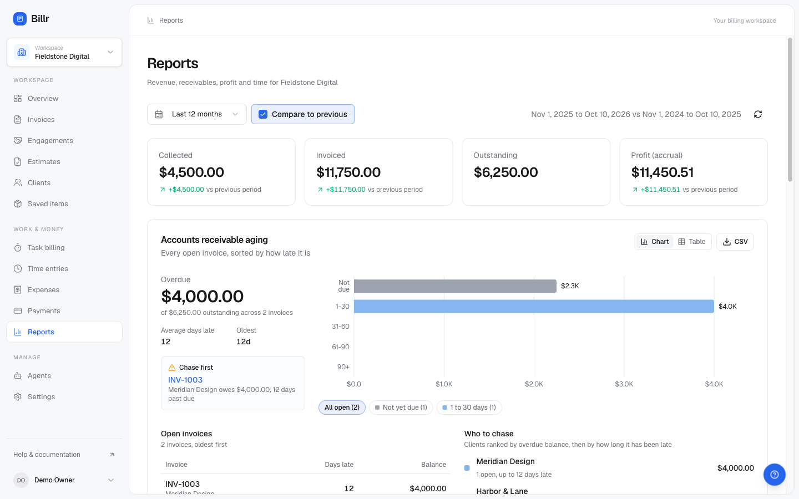

### Several brands and teammates

One Billr can hold several businesses, each with its own clients, numbering, branding, currency and agent keys, all paid into the same Stripe account. The workspace switcher at the top of the sidebar moves between them, and an API key can be pinned to exactly one, so a misbehaving prompt in one project cannot reach another brand's invoices.

Membership carries a role: `owner`, `admin` or `member`. Owner or admin is required to approve task pricing and approve a task invoice, and row-level security enforces the boundary in the database. To give a teammate a login, see "Sign-up and teammates" in [docs/self-hosting.md](docs/self-hosting.md).

## Running it on a server

[docs/self-hosting.md](docs/self-hosting.md) is the full guide: the database, environment variables, sign-up, the reverse proxy, card payments, email, upgrades and backups. In outline:

```sh
cd app
cp .env.example .env.local && chmod 600 .env.local   # then fill it in
npm ci
npm run check:config
docker compose --env-file .env.local build
docker compose --env-file .env.local up -d
```

The container runs as a non-root user and binds only `127.0.0.1:3000`, so you put your own HTTPS reverse proxy in front of it. Streaming HTTP through `/api/mcp` must pass unbuffered. Building the image needs at least 4 GB of memory available to Docker.

What you bring:

- **A Supabase project you own** (managed or self-hosted). Billr's Compose file runs the application, not a second copy of Supabase.
- **Your Stripe account**, if you want card payments. Leave the Stripe variables empty and everything else still works; you record payments as they arrive.
- **Your Resend account and a verified sender**, if you want Billr to email documents.

No keys, accounts or provider fallbacks are included, and nothing phones home.

## Architecture at a glance

- **Next.js app** (App Router, React, Tailwind, server actions) serving the workspace, the public document pages, the PDF renderer and the API routes.
- **Supabase Postgres** as the only store. Authorization lives in row-level security policies and `SECURITY DEFINER` functions with a pinned `search_path`; money arithmetic, document numbering, payment reconciliation and engagement schedules are enforced in SQL. Public document access goes only through allow-listed read-only functions keyed on a secret `public_id`.
- **MCP server** at `app/src/app/api/mcp`, with tools in `app/src/lib/mcp/tools`. Every tool reaches the database through a scoped client that filters by business.
- **OAuth 2.1 server** at `app/src/app/api/oauth` and `app/src/app/(auth)/oauth/authorize`: dynamic client registration, PKCE with S256, exact redirect matching, and access tokens that are ordinary API-key rows so one resolver stays the single gate in front of MCP.
- **`packages/agent-kit`**: the tool catalog, JSON input schemas and the money and time helpers, asserted against the tools the server registers.

```
app/
  src/app/(app)        the signed-in workspace
  src/app/(auth)       sign in, sign up, OAuth consent
  src/app/(public)     /i/<id> and /e/<id> client-facing documents
  src/app/api          mcp, oauth, stripe, auth, health, invoice PDFs
  src/lib/mcp          tool definitions, permissions, scoped database access
  src/lib/oauth        authorization server, scopes, connections
  src/lib/actions      server actions behind the workspace
  supabase/migrations  the schema: one baseline, then numbered changes
  supabase/tests       SQL tests (npm run test:sql)
packages/agent-kit     tool catalog, schemas and shared calculations
plugins                Codex and OpenClaw packages; other agent connection guides
docs                   self-hosting guide, fresh-machine test, screenshots
```

## Security

Report vulnerabilities privately as described in [SECURITY.md](SECURITY.md). Please do not open a public issue for one.

The guarantees the code is built around:

- A business's data is only readable by its members, and the check lives in the database.
- Client-facing document links are unguessable ids resolved by read-only functions that return an explicit list of fields. Your internal notes and your next invoice number are not among them.
- API keys are stored as hashes. Nobody, including whoever runs your installation, can read a key back after it is created.
- Every agent tool maps to exactly one permission, and anything uncategorised is refused.
- Pricing and the decision to bill are human actions that no key can perform.
- Payment webhooks are signature-checked and processed once.
- Only accounts this installation admitted can create a business; sign-up closes after the owner.

Your installation is yours to secure: the database, the backups, the secrets, the reverse proxy and the accounts.

## Contributing

Read [CONTRIBUTING.md](CONTRIBUTING.md) first. Everyone taking part follows the [Code of Conduct](CODE_OF_CONDUCT.md). Changes are listed in [CHANGELOG.md](CHANGELOG.md), and anything that is not a vulnerability report belongs in [SUPPORT.md](SUPPORT.md).

```sh
cd app
npm test
npm run test:installation
npm run lint
npm run typecheck
npm run build
```

Tests use fictional data. Never point tests at a database that holds real invoices.

## License

Apache-2.0, copyright Voyage Studios LLC, doing business as Billr. See [LICENSE](LICENSE) and [NOTICE](NOTICE). Third-party assets keep their own licenses. The Billr name identifies this project and does not imply that the Billr team operates or supports your installation.
